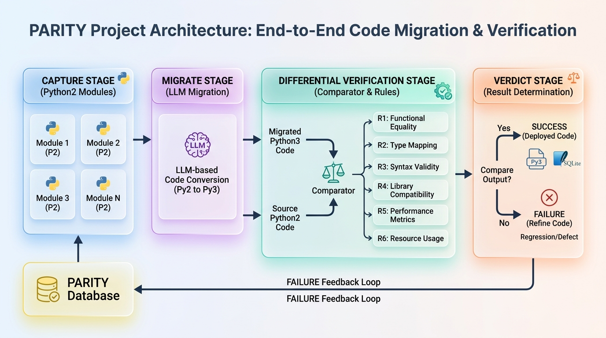

# PARITY – Python‑2‑to‑3 Differential Verification Engine



---

## Overview

**PARITY** is a research‑grade framework that evaluates **automatic Python 2 → Python 3 migration** performed by Large Language Models (LLMs).  It captures the exact runtime behaviour of a Python 2 module, runs an LLM‑generated migration, and then **differentially verifies** the two executions using a set of well‑defined comparator rules (R1‑R6).  The tool produces per‑module metrics such as:
- Silent‑regression catch rate
- False‑SAFE and false‑BLOCK rates
- Human‑migration agreement
- Execution time per module

All results are stored in a single SQLite database for traceability, and a full, reproducible evaluation pipeline is provided.

---

## Architecture

The pipeline consists of four main stages (see the diagram above):

1. **Capture** – Executes the original Python 2 module in a sandbox, records inputs, outputs, exceptions, and stdout/stderr as **type‑tagged JSON**.
2. **Migrate** – Sends the captured source to an LLM (configurable model) and receives a migrated Python 3 script.
3. **Verify** – Runs the migrated script in a separate sandbox and compares its tagged output to the captured behaviour using comparator rules:
   - **R1** – Text equality (str/unicode/str3) – never coerce bytes ↔ text.
   - **R2** – Integer/long numeric equality.
   - **R3** – Float equality with configurable tolerance.
   - **R4** – Mapping and set ordering (order‑independent comparison).
   - **R5** – Exception class & message matching (with configurable mapping).
   - **R6** – Timing differences are logged but never cause a divergence.
4. **Verdict** – Aggregates per‑module divergences into high‑level metrics, writes everything to the SQLite **`parity.db`**, and produces JSON reports under `eval/results/`.

The **SQLite schema** lives in `src/parity/db/schema.sql` and is version‑controlled; it stores captures, migrations, comparator logs, and final verdicts.

---

## Installation (one‑command local run)

```bash
# Clone the repo (already done) and install dependencies
pip install -e .
# Generate fixtures (captures, generated inputs, held‑out set)
python -m eval.generate_fixtures --corpus-dir eval/corpus --out-dir eval/fixtures
# Run the full evaluation (default arms A, B, C)
python -m eval.harness --run-all
```

All commands work on Windows, macOS, and Linux.  The repository ships with a `requirements.txt` that pins exact versions used during the study.

---

## Usage example (interactive demo)

```bash
# Run the demo on a single module
python demo/stage6_acceptance.py fixtures/01_integer_division
```

The demo prints the captured Python 2 behaviour, the LLM‑generated Python 3 code, the verification result, and a coloured verdict summary.

---

## Evaluation results

After a successful run you will find:
- `eval/results/` – JSON files for each arm (A, B, C) and the human reference.
- `eval/results/metrics.json` – aggregated metrics with 95 % bootstrap confidence intervals.
- `tests/reports/part2_findings.md` – list of bugs discovered during hostile review.

The repository includes a **Results Report** (`RESULTS_REPORT.md`) that explains how to reproduce the numbers shown in the paper.

---

## Contributing & Development

- Follow the coding style enforced by `ruff` and `black` (run `make lint`).
- Add new modules to `eval/corpus/` and update `PREREGISTRATION.md` accordingly.
- All new code must be covered by tests in the `tests/` directory.

---

## License

MIT – see the `LICENSE` file.

---

## Acknowledgements

Thanks to the **OpenAI**, **Anthropic**, and **Ollama** communities for providing the LLM back‑ends used in the experiments.
