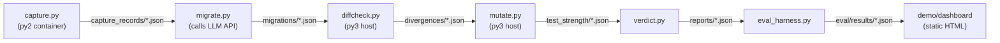
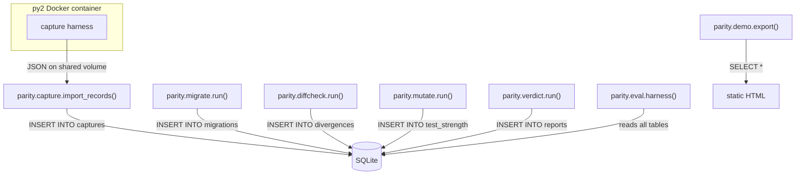
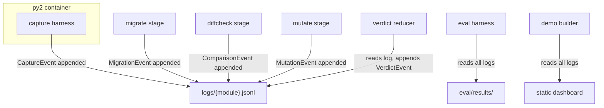

# PARITY: Three Architecture Options

> [!IMPORTANT]
> No recommendation is made. The three questions at the end are designed to discriminate between these options.

---

## Architecture A: "Pipeline-of-Files"

### Core idea
Each stage is a standalone CLI script that reads JSON files from disk and writes JSON files to disk. A thin orchestrator shell script calls them in sequence. No shared runtime, no database, no long-lived process.

### Data flow

**Capture**: A Python 2 Docker container imports the module, calls each entry point with recorded + generated inputs, serializes outputs as type-tagged JSON per CONTRACTS.md, writes one `CaptureRecord` JSON file per (module, entry_point, input).

**Migrate**: A script reads module source, sends it to the LLM (local Ollama or free API), parses output, writes a `MigrationResult` JSON file. One call per module per backend.

**Differential check**: Loads capture records, imports the migrated py3 module in the host, replays every input, compares outputs using comparator rules. Writes `Divergence` JSON files.

**Test strength**: Takes the migrated py3 code, applies mutation operators (swap `//` ↔ `/`, `bytes` ↔ `str`, `list()` wrapping removal, etc.), re-runs diffcheck on each mutant against the py3 baseline. Writes `TestStrength` JSON.

**Verdict**: Pure function: reads divergences, test strength, flags; applies the verdict table from CONTRACTS.md. Writes `ModuleReport` JSON.

**Eval harness**: Iterates Arms A/B/C across the corpus, collects ModuleReports, compares against ground truth (human migration), computes metrics. Writes to `eval/results/`.

**Demo**: A static HTML page generated from `eval/results/` JSON. No server.

### Failure modes
| Mode | Consequence |
|---|---|
| Capture container crashes | No capture file → verdict cannot be SAFE (fail closed, good) |
| Serialization `repr_fallback` overused | Many modules stuck at RISKY even if behaviorally identical |
| Diffcheck imports migrated code on host | If migrated code has side effects, host is affected |
| File naming collision | Silently overwrites a record; data loss |
| Mutation script too slow on large modules | Timeouts; test_strength = 0 → RISKY (safe failure) |

### What it's bad at
- **Iteration speed**: re-running one module means re-running every downstream stage or manually managing file dependencies.
- **Parallelism**: no built-in way to run multiple modules concurrently (you'd need GNU parallel or similar glue).
- **Traceability**: linking a divergence back through the chain requires matching filenames manually.

### Build effort (AI agent)
Low. Each script is independent, testable in isolation, no shared state. An agent can build and test one script per session. ~7 scripts + orchestrator + dashboard template. Estimate: 6–8 focused sessions.

### How it could silently yield a false SAFE
1. **Comparator bug**: a rule (e.g., R1 bytes-vs-text) is implemented wrong, marking a real divergence as "equal." Since comparator logic lives in one file (`diffcheck.py`), a single bug can affect every module.
2. **Input coverage gap**: generated inputs don't hit the divergent code path; mutation score is high because mutants happen to be on covered paths; verdict is SAFE but the uncovered path regresses.
3. **Stale capture files**: if capture is re-run with different inputs but old capture files aren't deleted, diffcheck uses a mix of old and new, potentially missing a regression that only appears with the new inputs.

### How easy to inspect
**High**. Every intermediate artifact is a human-readable JSON file on disk. You can `cat`, `jq`, diff, or version-control any artifact. The verdict is a pure function of files that exist at verdict time—fully reproducible.

---

## Architecture B: "In-Process Library with SQLite"

### Core idea
A single Python 3 package (`parity/`) with modules for each stage, sharing a SQLite database as the single source of truth. A CLI entry point (`python -m parity run <module>`) drives the pipeline. Capture still requires a py2 container but communicates via a shared volume + JSON import into SQLite.

### Data flow

**Capture**: Same py2 container, writes JSON to a shared volume. `parity.capture.import_records()` reads these and inserts into the `captures` table.

**Migrate**: `parity.migrate` reads module source, calls LLM, writes parsed code and metadata into `migrations` table.

**Differential check**: Reads from `captures` + `migrations`, replays, writes `divergences` table. Comparator rules are a pluggable class with a log table (`comparator_log`) that records every rule application.

**Test strength**: Reads migrated code from `migrations`, mutates, replays against capture inputs, writes `test_strength` table.

**Verdict**: SQL query joining `divergences`, `test_strength`, and flag columns. Result inserted into `reports`.

**Eval harness**: SQL queries across all modules for all three arms. Exports to `eval/results/` as JSON/CSV.

**Demo**: Reads from SQLite, generates a static HTML dashboard (or a lightweight Flask app for local browsing).

### Failure modes
| Mode | Consequence |
|---|---|
| SQLite corruption | Entire dataset lost; mitigated by WAL mode + periodic `.backup` |
| Schema migration errors | Columns missing → crashes (loud, good) |
| Concurrent writes from parallel module runs | SQLite write lock contention; serialized or errors |
| Capture import drops records silently | Missing captures → verdict can't be SAFE (fail closed) unless the count check is wrong |
| In-process migrated code execution | Migrated module runs in the same process as PARITY; a crash kills the verdict pipeline |

### What it's bad at
- **Isolation**: migrated py3 code runs in the same process. A `sys.exit()`, segfault, or monkey-patch in migrated code can corrupt PARITY's own state.
- **Debuggability under corruption**: if a SQLite row is wrong, tracing *why* requires reading code, not just inspecting files.
- **Portability**: SQLite file is binary; harder to diff, version-control, or inspect without tooling.

### Build effort (AI agent)
Medium. Requires designing a schema, writing migrations, and ensuring all stages interact correctly with the database. Shared types/models help but introduce coupling. More integration testing needed. Estimate: 8–12 sessions.

### How it could silently yield a false SAFE
1. **Comparator log not checked**: the comparator logs that it applied R4 (ordering), but the verdict query doesn't join on the log to verify *which* rules fired. A lenient rule fires silently.
2. **Capture import is lossy**: JSON → SQLite type coercion silently rounds a float or truncates a long string. The capture record in the DB doesn't match what py2 actually produced; diffcheck compares against the corrupted version.
3. **Query bug in verdict**: a SQL `WHERE` clause that checks `divergence_count = 0` doesn't filter by the correct module_id; it reads zero divergences for a module that actually has them.

### How easy to inspect
**Medium**. You can query the database with `sqlite3` CLI, but you need to know the schema. Intermediate state isn't visible as files. An export command (`parity dump <module>`) could help but has to be built and trusted.

---

## Architecture C: "Event-Sourced with Append-Only Log"

### Core idea
Every action (capture, migration, comparison, mutation, verdict) is an immutable **event** appended to a JSONL (JSON Lines) log file per module. The current state of any module is derived by replaying its event log. There is no mutable database. Verdicts are computed by a reducer function that walks the log.

### Data flow

**Every event has**: `timestamp`, `event_type`, `module`, `version` (monotonic), `payload` (the actual data matching CONTRACTS.md schemas), `checksum` (SHA-256 of the payload).

**Capture**: py2 container appends `CaptureEvent` entries directly to `logs/{module}.jsonl` (or writes JSON files that a log-import step appends).

**Migrate**: Appends `MigrationEvent` with full `MigrationResult` payload.

**Differential check**: Reads all `CaptureEvent`s for the module, replays against migrated code, appends one `ComparisonEvent` per (entry_point, input) with the full divergence or "match" result.

**Test strength**: Appends `MutationEvent`s (one per mutant) with kill/survive result.

**Verdict**: A pure reducer function reads the log top-to-bottom, accumulates state (capture count, divergence count, test strength, flags), and applies the verdict table. Appends a `VerdictEvent`. If any earlier event is missing or malformed, verdict is RISKY or lower.

**Re-runs**: If you re-capture or re-migrate, new events are appended (old ones remain). The reducer uses the *latest version* of each event type. The full history is preserved for auditing.

**Eval harness**: Reads all module logs, extracts the latest `VerdictEvent` from each, compares against ground truth.

**Demo**: Static HTML built from log data.

### Failure modes
| Mode | Consequence |
|---|---|
| Log file corrupted mid-write | Checksum mismatch on last line; reducer stops and reports error (loud) |
| Reducer logic bug | Wrong verdict; but the log contains all raw data for manual verification |
| Log grows large (hundreds of re-runs) | Slow replay; mitigated by compaction (snapshot) but compaction is itself a correctness risk |
| Events written out of order (race condition) | Version numbers detect this; reducer refuses to proceed |
| Py2 container can't append directly to JSONL | Need an import shim, adding a step |

### What it's bad at
- **Complexity for the scale**: event sourcing is powerful but arguably over-engineered for 30–60 modules with a linear pipeline. The reducer logic is subtle and a bug source.
- **Querying across modules**: to answer "which modules had R4 applied?", you must replay every module's log. No index, no SQL.
- **Agent cognitive load**: AI agents may struggle with the event-replay pattern; more likely to introduce reducer bugs than simple file-read or SQL bugs.

### Build effort (AI agent)
Medium-high. The event schema, reducer, versioning, and checksum logic require careful design. Each stage is simple (append a JSON line) but the reducer is critical and non-trivial. Estimate: 10–14 sessions.

### How it could silently yield a false SAFE
1. **Reducer skips an event**: a bug causes the reducer to skip a `ComparisonEvent` with a divergence (e.g., wrong version filter), so it sees zero divergences.
2. **Checksum bypass**: if the checksum validation is optional or off by default, a corrupted capture event (with truncated output) could make a divergent behavior look like a match.
3. **Stale latest-version logic**: the "use latest version" rule picks up a re-capture that accidentally used fewer inputs than the original, so the divergent input simply isn't in the log anymore.

### How easy to inspect
**Very high for single modules**. `cat logs/mymodule.jsonl | jq .` shows the complete, ordered history of everything that happened. Every decision is traceable. **Low for cross-module queries** without tooling.

---

## Comparison matrix

| Dimension | A: Pipeline-of-Files | B: SQLite Library | C: Event-Sourced Log |
|---|---|---|---|
| **Data format** | Flat JSON files per stage | SQLite tables | JSONL per module |
| **State management** | Implicit (files exist or don't) | Explicit (DB rows) | Derived (replay log) |
| **Isolation of migrated code** | Separate process (if scripted) | Same process (risky) | Separate process (if scripted) |
| **Parallelism** | Manual (xargs/parallel) | SQLite write lock limits | Per-module files, natural parallelism |
| **Inspectability** | High (files) | Medium (SQL queries) | High per module, low cross-module |
| **Traceability** | Low (filename matching) | Medium (foreign keys) | Very high (event chain) |
| **Build effort** | 6–8 sessions | 8–12 sessions | 10–14 sessions |
| **False-SAFE surface** | Comparator bug, stale files | Comparator bug, SQL bug, type coercion | Reducer bug, version logic, checksum bypass |
| **Biggest strength** | Simplicity, fast to build, easy to debug | Structured queries, single source of truth | Full audit trail, immutable history |
| **Biggest weakness** | No built-in traceability or cross-module queries | Process isolation, binary format | Over-engineered for this scale, reducer complexity |

---

## Three questions whose answers would most change the ranking

### Q1: How important is post-hoc cross-module analysis?
If you need to routinely ask questions like *"which comparator rule was applied most often?"* or *"list all modules where R4 fired and the verdict was SAFE"*, Architecture B (SQL) is strongly favored. If you only care about per-module verdicts and a final eval summary, A or C work fine and B's overhead isn't justified.

### Q2: Will you re-run stages iteratively during development, or is it mostly one-shot per module?
If you expect many re-runs (tuning the comparator, regenerating inputs, trying different LLM prompts), Architecture C's append-only history gives you automatic diffing of "what changed between run 3 and run 7." Architecture A requires manual file management (risk of stale files → false SAFE). Architecture B overwrites rows (history lost unless you add versioning, which approaches C's complexity anyway).

### Q3: How much do you trust AI agents to get a reducer / SQL schema right vs. getting simple file I/O right?
If you expect the builder agent to be weakest at subtle stateful logic (which is likely for current models), Architecture A's "each script is a pure function from files to files" is safest—bugs are local and easy to find. If the agent can handle schema design and SQL correctly, B gives more structure. C's reducer is the hardest to get right and the most dangerous if wrong (a reducer bug is a silent false-SAFE path).
