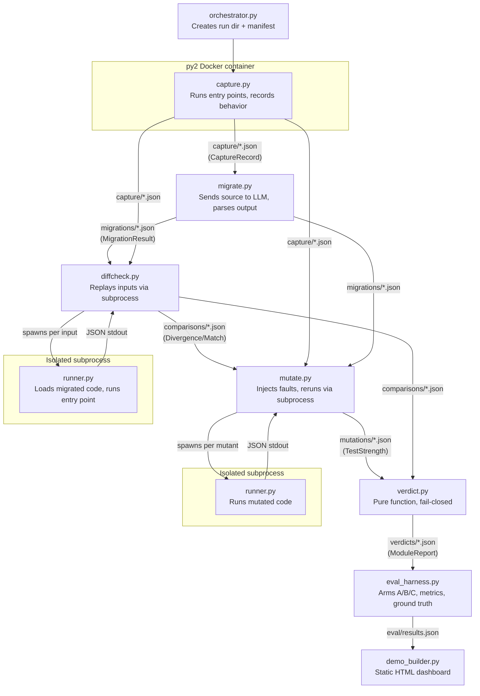

# Enhanced A+ Architecture Specification

> [!IMPORTANT]
> This is the full specification for Architecture "Enhanced A+" — the Pipeline-of-Files design hardened against its known failure modes. It preserves A's core properties (standalone CLI stages, JSON artifacts, filesystem pipeline, process isolation) and adds provenance tracking, hash verification, immutable runs, and subprocess isolation.

---

## 1. Immutable Run Model

### Run ID
Every pipeline execution gets an immutable **run ID**: `{ISO-timestamp}_{uuid4-short}`.
Example: `20261004T182400Z_a1b2c3d4`.

- Generated once at the start of a run by the orchestrator.
- Passed to every stage as a required `--run-id` argument.
- A stage that receives a run ID not matching its input artifacts **refuses to execute**.

### Per-Run Directory
All artifacts for a run live under `runs/{run_id}/`. Nothing is ever written outside this directory during a run. Nothing inside it is ever modified after creation.

```
runs/
  20261004T182400Z_a1b2c3d4/
    manifest.json
    capture/
      {module}__{entry_point}__{input_hash}.json
    migrations/
      {module}__{backend}.json
    comparisons/
      {module}__{entry_point}__{input_hash}.json
    mutations/
      {module}__test_strength.json
    verdicts/
      {module}__report.json
    eval/
      results.json
    demo/
      index.html
```

### Immutability Rule
- Stages **append** artifacts to their subdirectory. They never overwrite, rename, or delete.
- If a file already exists at the target path, the stage **aborts with an error** (duplicate artifact).
- Re-runs require a new run ID and a fresh directory.

---

## 2. Manifest

Every run has a `manifest.json` created by the orchestrator at run start and **sealed** (checksummed) at run end.

```json
{
  "run_id": "20261004T182400Z_a1b2c3d4",
  "created_at": "2026-10-04T18:24:00Z",
  "status": "in_progress | complete | failed",
  "corpus": {
    "modules": ["legacy_csv_parser", "legacy_math_utils"],
    "source": "corpus definition reference",
    "selection_rule": "first N meeting criteria"
  },
  "tool_versions": {
    "orchestrator": "0.1.0",
    "capture": "0.1.0",
    "migrate": "0.1.0",
    "diffcheck": "0.1.0",
    "mutate": "0.1.0",
    "verdict": "0.1.0"
  },
  "config": {
    "schema_version": "1.0",
    "input_generator_version": "0.1.0",
    "input_generator_seed": 42,
    "comparator_version": "0.1.0",
    "comparator_config": { "float_tolerance": "exact", "exception_mapping": {} },
    "llm_backend": "ollama/codellama",
    "llm_temperature": 0.0
  },
  "stages": {
    "capture":     { "started_at": null, "completed_at": null, "artifact_count": 0, "artifact_hashes": {} },
    "migrate":     { "started_at": null, "completed_at": null, "artifact_count": 0, "artifact_hashes": {} },
    "diffcheck":   { "started_at": null, "completed_at": null, "artifact_count": 0, "artifact_hashes": {} },
    "mutate":      { "started_at": null, "completed_at": null, "artifact_count": 0, "artifact_hashes": {} },
    "verdict":     { "started_at": null, "completed_at": null, "artifact_count": 0, "artifact_hashes": {} }
  },
  "seal": null
}
```

### Manifest lifecycle
1. **Created** by orchestrator with tool versions, config, module list. `status = "in_progress"`.
2. **Updated** after each stage completes: artifact count and per-artifact SHA-256 hashes recorded.
3. **Sealed** after all stages: `seal = SHA-256(canonical JSON of everything above except seal)`. `status = "complete"` or `"failed"`.
4. After sealing, **the manifest is never modified again**.

### Manifest update rule
Only the orchestrator writes to the manifest. Stages return their artifact list and hashes to stdout; the orchestrator records them. Stages never touch `manifest.json` directly.

---

## 3. Artifact Envelope

Every JSON artifact file follows this envelope schema:

```json
{
  "envelope": {
    "run_id": "20261004T182400Z_a1b2c3d4",
    "module": "legacy_csv_parser",
    "stage": "capture",
    "schema_version": "1.0",
    "tool_version": "0.1.0",
    "created_at": "2026-10-04T18:25:03Z",
    "parent_artifacts": [
      {
        "path": "relative/path/to/input/artifact.json",
        "sha256": "abc123..."
      }
    ],
    "payload_sha256": "def456..."
  },
  "payload": {
    "...CONTRACTS.md schema fields..."
  }
}
```

### Field definitions
| Field | Purpose |
|---|---|
| `run_id` | Must match the run directory and manifest |
| `module` | Which module this artifact is about |
| `stage` | Which pipeline stage produced this (`capture`, `migrate`, `diffcheck`, `mutate`, `verdict`) |
| `schema_version` | Version of the payload schema (from CONTRACTS.md) |
| `tool_version` | Version of the CLI tool that produced this artifact |
| `created_at` | ISO 8601 timestamp |
| `parent_artifacts` | List of input artifacts this was derived from, each with relative path and SHA-256 hash |
| `payload_sha256` | SHA-256 of the canonicalized `payload` JSON |

### Payload contents
The `payload` contains exactly the fields defined in CONTRACTS.md for the corresponding record type:
- `capture` → CaptureRecord fields
- `migrate` → MigrationResult fields
- `diffcheck` → Divergence fields (or explicit "match" record)
- `mutate` → TestStrength fields
- `verdict` → ModuleReport fields

---

## 4. Pre-Stage Validation

Every stage performs these checks **before doing any work**. If any check fails, the stage exits with a non-zero code and writes nothing.

### Universal checks (all stages)
| Check | What fails | Exit behavior |
|---|---|---|
| `manifest.json` exists in run directory | Missing manifest | Abort, error message |
| `manifest.run_id` matches `--run-id` argument | Run ID mismatch | Abort |
| `manifest.status` is `"in_progress"` | Run already complete/failed | Abort |
| `manifest.tool_versions[this_stage]` matches this binary's version | Tool version mismatch | Abort |
| `manifest.config.schema_version` matches this binary's expected schema | Schema version mismatch | Abort |

### Input-artifact checks (stages that consume prior output)
| Check | What fails | Exit behavior |
|---|---|---|
| All required input artifacts exist on disk | Missing artifact | Abort |
| Each input artifact's `envelope.run_id` matches | Cross-run artifact | Abort |
| Each input artifact's `envelope.schema_version` matches manifest | Schema mismatch | Abort |
| Each input artifact's `envelope.tool_version` matches manifest | Tool version mismatch | Abort |
| SHA-256 of input artifact file matches hash in manifest | Corrupted/tampered artifact | Abort |
| SHA-256 of `payload` matches `envelope.payload_sha256` | Internal inconsistency | Abort |
| Input artifact count matches manifest's recorded count for that stage | Missing or extra artifacts | Abort |
| No unexpected files in the input stage directory | Stale/foreign artifacts | Abort |

### Stage-specific checks

**diffcheck** additionally verifies:
- Every capture artifact has `deterministic: true` OR `non_determinism_reason` is documented and the comparison accounts for it.
- The `comparator_version` in each comparison artifact matches `manifest.config.comparator_version`.

**verdict** additionally verifies:
- Comparison artifacts exist for every (module, entry_point, input) combination present in capture.
- Mutation artifacts exist for every module.
- No artifact is counted twice (unique filenames enforced by path structure).

---

## 5. Subprocess Isolation

### Problem
Migrated Python 3 code is untrusted. It may have import-time side effects, modify `sys.path`, `os.environ`, call `sys.exit()`, or crash.

### Solution
The `diffcheck` stage **never imports migrated code in its own process**. Instead:

```
diffcheck.py (parent)
    │
    ├── For each (entry_point, input):
    │     │
    │     ├── subprocess.run(
    │     │     ["python3", "runner.py",
    │     │      "--module-path", migrated_module_path,
    │     │      "--entry-point", entry_point,
    │     │      "--input-file", serialized_input_path],
    │     │     capture_output=True,
    │     │     timeout=TIMEOUT_SECONDS,
    │     │     env=CLEAN_ENV
    │     │   )
    │     │
    │     ├── Parse stdout (JSON with type-tagged output)
    │     ├── Compare against capture record
    │     └── Write comparison artifact
```

### `runner.py` contract
- Receives: module path, entry point name, path to serialized input JSON.
- Does: imports the module, deserializes input, calls entry point, serializes output.
- Returns: JSON to stdout with the same type-tagged format as CaptureRecord outputs.
- On error: writes structured error JSON to stdout (never stderr for data), exits non-zero.
- **Has no access to** the run directory, manifest, or any PARITY internals. It receives only what it needs via arguments.

### Environment isolation
- `env=CLEAN_ENV`: a minimal environment dict (only `PATH`, `PYTHONPATH` pointing to the migrated module, `HOME`). No inherited env vars.
- `cwd`: a temporary directory, not the run directory.
- `timeout`: configurable, default 30 seconds. Timeout → comparison artifact records "timeout", verdict capped at RISKY.

### Mutation testing
Same pattern: `mutate.py` runs each mutated version of the migrated code in a subprocess via `runner.py`. A subprocess crash or timeout counts as "mutant killed" (conservative).

---

## 6. Deterministic Verdict

### Inputs
`verdict.py` reads ONLY:
- `manifest.json` (for expected counts and hashes)
- `comparisons/{module}__*.json` (all comparison artifacts for this module)
- `mutations/{module}__test_strength.json`

### Computation
1. **Validate** all input artifacts (Section 4 checks).
2. **Count** divergences by category, applying the severity rules from CONTRACTS.md.
3. **Read** test strength score.
4. **Apply** the verdict table from CONTRACTS.md, top to bottom, first matching condition wins.
5. **Collect** evidence list: references to specific comparison artifacts showing divergences.
6. **Write** `verdicts/{module}__report.json` with full ModuleReport payload.

### Determinism guarantee
- No randomness, no timestamps in verdict logic (timestamps are metadata in the envelope only).
- No environment variables consulted.
- No network calls.
- Same input artifacts → same verdict, always.
- The verdict function is a **pure function** of its validated inputs.

### Fail-closed enforcement
The verdict function checks these conditions **in order** and takes the **minimum** verdict:

```
if any validation check failed:          → BLOCKED (stage should have aborted, but defense in depth)
if any divergence exists:                → BLOCKED
if any internal error in comparison:     → min(RISKY, current)
if any timeout in comparison:            → min(RISKY, current)
if any unparsed migration:               → min(RISKY, current)
if non-determinism unresolved:           → min(RISKY, current)
if any lossy serialization:              → min(RISKY, current)
if test_strength < threshold:            → min(RISKY, current)
if unsupported construct flagged:        → min(RISKY, current)
if all checks pass:                      → SAFE
```

---

## 7. Complete Data Flow



### Stage dependency chain
```
orchestrator → capture → migrate → diffcheck → mutate → verdict → eval → demo
```

Each arrow means: the downstream stage validates the upstream stage's artifacts before starting. No stage can run until all its inputs are present, validated, and recorded in the manifest.

---

## 8. Orchestrator

`orchestrator.py` is the only entry point for a full run.

```
python -m parity.orchestrator \
  --corpus fixtures/corpus.json \
  --config config.yaml \
  [--modules mod1,mod2]   # optional: subset
```

### Responsibilities
1. Generate run ID.
2. Create `runs/{run_id}/` and all subdirectories.
3. Write initial `manifest.json` with tool versions, config, module list.
4. Call each stage CLI in sequence, passing `--run-id` and `--run-dir`.
5. After each stage: read stage's artifact list from stdout, compute hashes, update manifest.
6. If any stage exits non-zero: set `manifest.status = "failed"`, record which stage and why, stop.
7. After all stages: seal the manifest.

### No magic
The orchestrator is a **linear script**. No DAG engine, no task queue, no parallelism in v1. It calls stages in order. Parallelism across modules can be added later by running multiple orchestrator instances with `--modules` subsets (each gets its own run ID).

---

## 9. Test Matrix: Proving Failure Modes Fail Closed

Each test creates a specific invalid condition and asserts that the pipeline **cannot produce SAFE**.

| # | Failure mode | Setup | Assert |
|---|---|---|---|
| T1 | **Stale files** | Copy a capture artifact from a previous run into the current run's `capture/` dir | Stage aborts: `run_id` mismatch in artifact envelope |
| T2 | **Mixed runs** | In `comparisons/`, place one artifact with run_id X and one with run_id Y | Verdict stage aborts: inconsistent run_ids |
| T3 | **Wrong tool version** | Modify `manifest.tool_versions.diffcheck` to "0.0.0" but run diffcheck v0.1.0 | Diffcheck aborts: tool version mismatch |
| T4 | **Wrong schema version** | Create a capture artifact with `schema_version: "0.9"` when manifest says `"1.0"` | Diffcheck aborts: schema version mismatch |
| T5 | **Missing artifacts** | Delete one capture artifact after capture stage completes | Diffcheck aborts: expected artifact count mismatch AND missing file |
| T6 | **Duplicate artifacts** | Attempt to write a capture artifact to a path that already exists | Capture stage aborts: file already exists |
| T7 | **Corrupted artifact** | Flip one byte in a capture artifact's payload | Diffcheck aborts: SHA-256 hash mismatch |
| T8 | **Tampered payload hash** | Modify `payload` and update `envelope.payload_sha256` but not the manifest hash | Diffcheck aborts: manifest hash doesn't match file hash |
| T9 | **Cross-run parent** | In a comparison artifact, set `parent_artifacts[0].sha256` to a hash from a different run | Verdict stage aborts: parent hash doesn't match any manifest-recorded hash |
| T10 | **Missing comparison for an input** | Delete one comparison artifact, leaving capture artifact without a corresponding comparison | Verdict aborts: comparison count doesn't match capture count for module |
| T11 | **Foreign file in stage dir** | Place a non-artifact file (e.g., `notes.txt`) in `comparisons/` | Diffcheck aborts: unexpected file in stage directory |
| T12 | **Sealed manifest** | Run a stage against a manifest with `status: "complete"` | Stage aborts: run already complete |
| T13 | **Subprocess crash** | Provide a migrated module that calls `sys.exit(1)` at import | Comparison artifact records error; verdict ≤ RISKY |
| T14 | **Subprocess timeout** | Provide a migrated module with `while True: pass` | Comparison artifact records timeout; verdict ≤ RISKY |
| T15 | **Subprocess env leak** | Migrated module reads `os.environ["PARITY_SECRET"]`; set it in parent env | Runner uses CLEAN_ENV; module gets `KeyError`; recorded as error; verdict ≤ RISKY |

### Test implementation approach
Each test is a Python `pytest` function that:
1. Sets up a minimal run directory with valid artifacts for a toy module.
2. Introduces exactly one defect.
3. Calls the stage CLI (or the verdict function directly for verdict tests).
4. Asserts: either the stage exits non-zero, or the verdict is ≤ RISKY.
5. Asserts: the verdict is **never** SAFE under the defective condition.

---

## 10. What This Design Does NOT Do

Kept out of scope to preserve simplicity:

- **No DAG engine or task scheduler.** Linear pipeline, one run at a time.
- **No incremental re-runs.** If you change one thing, you start a new run. Immutability means no partial updates.
- **No cross-run comparison built-in.** You can diff two `eval/results.json` files manually or with a script. Not a core feature.
- **No database.** All state is JSON files on disk.
- **No web server.** Demo is static HTML.
- **No encryption or signing.** SHA-256 hashes detect accidental corruption and mixing, not adversarial tampering.
- **No parallelism in v1.** Modules run sequentially within a run. Parallelism is a future optimization.

---

## 11. File Inventory (what to build)

| File | Purpose | Approx. size |
|---|---|---|
| `src/parity/orchestrator.py` | Run lifecycle, manifest management | ~200 lines |
| `src/parity/envelope.py` | Envelope creation, validation, hashing | ~150 lines |
| `src/parity/capture.py` | Py2 capture harness (runs inside container) | ~200 lines |
| `src/parity/migrate.py` | LLM migration caller + parser | ~150 lines |
| `src/parity/diffcheck.py` | Replay + compare via subprocess | ~250 lines |
| `src/parity/runner.py` | Isolated execution of migrated code | ~100 lines |
| `src/parity/mutate.py` | Mutation operators + test strength | ~200 lines |
| `src/parity/verdict.py` | Pure verdict function | ~150 lines |
| `src/parity/eval_harness.py` | Arms A/B/C evaluation | ~200 lines |
| `src/parity/demo_builder.py` | Static HTML generator | ~150 lines |
| `src/parity/comparator.py` | Comparator rules R1–R6 | ~200 lines |
| `src/parity/serializer.py` | Type-tagged JSON serialization | ~200 lines |
| `tests/test_provenance.py` | T1–T12 provenance/integrity tests | ~300 lines |
| `tests/test_isolation.py` | T13–T15 subprocess isolation tests | ~150 lines |
| `tests/test_comparator.py` | Comparator rule unit tests | ~200 lines |
| `tests/test_verdict.py` | Verdict truth table tests | ~200 lines |
| **Total** | | **~2,800 lines** |
